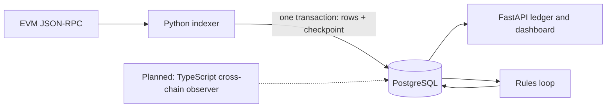

# Arc Sentinel

**A read-only wallet activity monitor focused on recoverable EVM event indexing.**

Arc Sentinel indexes registered wallets' transactions and USDC transfers into PostgreSQL, exposes a FastAPI ledger and dashboard, and evaluates budget, recipient and anomaly rules. It is a backend engineering portfolio project moving toward an operator-run testnet pilot.

**Current maturity:** tested local prototype. No live-service availability, benchmark, mainnet readiness, or cross-chain support is claimed. The next release gates are in [the roadmap](docs/ROADMAP.md).

## Agent and contributor navigation

Start with [AGENTS.md](AGENTS.md) and [the project map](docs/INDEX.md). Code, tests and component documents ship together; CI enforces ownership, local links and document co-change. See [the workflow](docs/WORKFLOW.md).

## Why this project

An event monitor is useful only if it can explain missing data, duplicate delivery and recovery after failure. This repository makes those contracts visible in code and PostgreSQL integration tests, rather than relying on a successful RPC happy path.



Python 3.12 · FastAPI · SQLAlchemy · PostgreSQL · Alembic · HTTP JSON-RPC · Docker

## Implemented reliability contracts

| Concern | Behavior | Evidence |
| --- | --- | --- |
| Interrupted batch | Rows and checkpoint commit together; an exception rolls both back | `test_indexer_recovery_pg.py` |
| Incomplete provider data | Missing/wrong blocks, missing receipts, invalid receipt status, malformed/removed token logs and non-array log responses fail the batch | Worker and RPC unit tests; PostgreSQL retry tests |
| Replay | Database uniqueness deduplicates transactions and transfer identities | `test_worker_pg.py` |
| Competing indexers | Nonblocking PostgreSQL transaction advisory lock, scoped per chain/database | Real competing database sessions in recovery tests |
| Backfill | Optional inclusive `START_BLOCK` for a new checkpoint; existing checkpoint wins | Genesis, historical and future-start tests |
| Wrong network | `eth_chainId` checked at the beginning of every cycle | Wrong-chain integration test |
| Provider failure | Bounded concurrent fetches, RPC retry/backoff and fallback provider support | `test_rpc_client.py` |

A failed decode intentionally stops progress. Operators repair the cause and replay; there is no silent quarantine/skip policy. The advisory lock covers the whole poll transaction, including RPC waits. It is simple and correctness-oriented, with throughput and connection-pool tradeoffs.

## Verify locally without chain credentials

Prerequisites: Python 3.12, [uv](https://docs.astral.sh/uv/), and Docker running for the PostgreSQL tests.

```sh
uv sync --frozen
./scripts/verify.sh
# Focused failure/recovery demonstration, also included in the full suite:
uv run python -m pytest tests/integration/test_indexer_recovery_pg.py -v
# DB-free development:
uv run python -m pytest tests/unit -q
```

Integration tests start a disposable PostgreSQL container on port 15432 and mock JSON-RPC. They do not need RPC credentials, private keys, a funded wallet, or a real network. The current fixture uses a fixed container name/port: run one integration suite at a time.

For an interactive API and an eventual pilot, use [the runbook](docs/RUNBOOK.md). The runtime image runs as a non-root user. CI runs lint, unit/integration tests and an image build on pull requests; only `main` builds publish an image, from a separate job. The deployment workflow is disabled pending a separate deployment review (see [SECURITY.md](SECURITY.md)).

## Verification recorded on 2026-11-11

On the merged release candidate, `./scripts/verify.sh` passed component mapping/links and Ruff; **249 tests passed**, including integration tests against disposable PostgreSQL with mocked JSON-RPC. They cover row/checkpoint atomicity, competing indexers blocked by the advisory lock, chain ID and block hash/parent lineage checks, and fork detection that latches a recovery-required state reported by `/health`. Gitleaks found no leaks in the new commits or working tree; `pip-audit` of `uv.lock` reported no known vulnerabilities. No live-chain, load or container vulnerability test was performed. Details: [verification record](docs/VERIFICATION.md), [security scope](SECURITY.md).

## Scope and known limits

- **One chain per database.** Transaction and transfer keys are not chain-scoped; this schema must change before a second chain shares the database.
- **No automatic chain reorganization recovery yet.** A confirmation buffer is not finality. Hash/parent/member checks stop inconsistent batches; forked checkpoints trigger bounded ancestor diagnosis and a persistent recovery-required state exposed by `/health`. Mid-cycle provider changes force retry. Rollback, replay and derived-data repair remain launch blockers; stored reads can still contain pre-repair branch data.
- New wallets are observed prospectively unless an explicit rescan is performed. A new database defaults to anchoring at the current safe head when `START_BLOCK` is unset.
- One transaction currently maps to one agent; transfers between two monitored wallets need a separate wallet-ledger projection before multi-user rollout.
- The rules loop runs inside the API process; it is neither a durable workflow engine nor safe evidence of exactly-once alerts across API replicas.
- Read routes expose wallet activity and labels. Authentication/tenant boundaries, rate limits and data-retention policy must be decided before accepting users' data.
- Gas conversion currently assumes Arc's native USDC accounting (18 native decimals versus 6 ERC-20 decimals). Do not apply `gas_fee_usdc` to an ETH-gas chain without a separate native-currency model and valuation policy. [Arc's explanation](https://www.arc.io/blog/building-with-usdc-on-arc-one-token-two-interfaces).
- No AWS infrastructure, TypeScript service, durable cross-chain workflow or live-chain/load benchmark is implemented in this milestone.

## Engineering and application material

- [Roadmap and measurable launch gates](docs/ROADMAP.md)
- [Architecture decisions and failure semantics](docs/ARCHITECTURE.md)
- [Pilot deployment, recovery and rollback runbook](docs/RUNBOOK.md)
- [Verification record](docs/VERIFICATION.md)
- [Security scope and operational limits](SECURITY.md)
- [Historical specification](docs/SPEC-v1.0-2026-09-16.md) — design context; current code, tests and the roadmap take precedence over historical deployment claims.

The planned TypeScript observer will track cross-chain message lifecycle and operational delays. It will not be presented as a bridge, a DVN, or a proof of message validity. See the roadmap for the event-correlation and workflow design.
