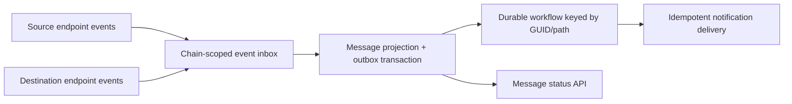

# Roadmap: prototype → testnet pilot → credible blockchain backend portfolio

[Project map](INDEX.md)

Updated 2026-10-30. This is an execution plan, not a claim that future phases exist. Complete each gate before expanding scope. Keep the existing Python indexer; add TypeScript where cross-chain orchestration benefits from it rather than rewriting working code.

## Product and target user

Help one operator answer: “What did these wallets transfer, how current is the ledger, and which expected cross-chain messages have not completed?”

First release: read-only testnet monitoring for operator-owned demo wallets, one chain/database, one indexer and one API process. Start with reproducible synthetic fixtures, then collect a small real testnet evidence set. Do not accept customer funds or require wallet private keys. An operational testnet pilot is a more realistic first launch than a multi-tenant mainnet product.

## Milestones and acceptance criteria

| Order | Deliverable | Exit gate | Hiring evidence |
| --- | --- | --- | --- |
| M0 — verified baseline | Fail-closed batches, single writer, explicit backfill start, CI/image repair and runbook | Lint, full PostgreSQL suite, image build and smoke test pass; limits remain explicit | Transaction boundaries, recovery testing, deployment judgment |
| M1 — in progress | Canonical history and wallet ledger | Fork fixtures replace 1/3/10 blocks; remove orphaned rows, repair summaries/alerts, replay canonical branch; crash at every rollback/commit boundary leaves a consistent checkpoint | Reorg handling and data modelling |
| M2 | Two-chain TypeScript message observer + durable workflows | Mocked send/verify/deliver fixtures correlate correctly even when delivered before sent; restart worker during wait; duplicate/out-of-order events do not duplicate notifications | TypeScript, distributed state machines, interoperability |
| M3 | AWS testnet pilot | Terraform creates a reproducible stack; seven-day observation, successful restore drill and bounded-cost report; no unexplained missing events in a pinned reference range | Cloud operations and measured reliability |
| M4 | Public portfolio release | Fresh-machine demo verified; evidence folder populated; current CI green; 3-minute demo and concise design narrative; code/history reviewed before public visibility | Reviewable ownership and engineering communication |

Suggested work breakdown: one focused PR per milestone subtask below. Do M1 before starting M2 implementation. M3 research can overlap with M2, but deploy only after M1 passes. Calendar estimates depend on available time and network/provider constraints; the gates determine readiness.

## M1: canonical history before public pilot

1. **Foundation implemented:** additive `indexed_blocks` journal keyed by `(chain_id, block_number)` with hash, parent hash, timestamp, observed provider and anchor provenance. Populated-baseline migration preservation is tested. **Remaining:** add chain ID/block hash to raw event identities and foreign keys; plan the migration from the current single-chain tables. Transaction hash alone is insufficient for cross-chain storage.
2. **Foundation implemented:** validate contiguous parent hashes, transactions/receipts/logs against fetched block identities/ranges, and reread the batch boundary before committing. Reject any mid-cycle provider change and recheck chain identity; clean fallback retries are tested. Check the saved checkpoint hash even when caught up. Legacy checkpoints without hashes stop rather than fabricate provenance. These checks do not prove provider completeness or implement fork repair.
3. **Diagnostic search and visible stop implemented; recovery remaining:** checkpoint forks search contiguous provider headers for a journal match within `REORG_MAX_DEPTH`. The common ancestor or a window/provenance failure reason persists with detection time; health remains degraded even at zero lag and after restart. Unstable/provider-switched searches do not latch. There is no automatic reset or rollback. Never silently reset to the head.
4. Roll back orphaned transactions/transfers in FK-safe order and either invalidate or rebuild affected alerts and daily summaries in the same recovery protocol. Add explicit canonical/orphaned provenance rather than leaving stale derived data visible as current truth.
5. Separate raw transactions/events from per-wallet ledger entries. Test both wallets being monitored, self-transfers, relayer transfers and contract creation. Make onboarding/backfill per wallet or document an operator-only registration cutover.
6. Publish a deterministic fork/replay demo. Assert the final ledger equals a clean replay of the canonical fixture, not merely that row counts look plausible.

## M2: TypeScript interoperability slice

Choose one verified LayerZero V2 testnet pathway and a demo OApp after checking current official endpoint deployments and supported networks. Do not assume Arc has a supported LayerZero pathway. Store the selected endpoint addresses, ABI revision, EVM chain IDs and LayerZero endpoint IDs (EIDs) in a reviewed network registry; EIDs and chain IDs are distinct identifiers.

Proposed module: `services/message-observer/` using TypeScript and an EVM client, with a durable workflow engine such as Temporal. Pin tool/dependency versions when implementation starts.

Data flow:

- Preserve raw events keyed by chain, block hash, transaction hash and log index. Correlate message GUID with source/destination EID, sender, receiver and nonce; validate against pinned protocol ABIs and packet encoding.
- Model observation states (`sent_observed`, `verified_observed`, `delivered_observed`, `observation_overdue`, `orphaned`). “Overdue” means an observer deadline expired; it does not prove protocol failure. Keep facts and derived workflow status separate.
- Use an inbox/outbox pattern to bridge database updates and workflow signals. Expect at-least-once delivery, stable idempotency keys, late/out-of-order events and reconciliation after missing signals.
- Workflow waits must survive process restarts. Bound retries and per-provider timeouts, expose retry exhaustion, and provide a manual reconciliation command. Notifications need a durable deduplication record.
- Tests: duplicate packets, delivery-before-send, destination outage, timeout followed by late delivery, source reorg, a crash between DB commit and signal dispatch, and a crash after notification send before acknowledgement.
- Demo only after fixture tests pass: publish source/destination testnet transaction links and observation timestamps. Do not invent throughput, deployment usage or verified-security claims.

Protocol references: [LayerZero V2 architecture and message lifecycle](https://layerzero.network/blog/layerzero-v2-deep-dive), [official EndpointV2 implementation](https://github.com/LayerZero-Labs/LayerZero-v2/blob/main/packages/layerzero-v2/evm/protocol/contracts/EndpointV2.sol). This roadmap is an engineering proposal inferred from those interfaces, not an official LayerZero design.

## M3: AWS and operational gate

Proposed first AWS architecture: ECS/Fargate services for API/indexer/workflow worker, RDS PostgreSQL, CloudWatch logs/metrics, Secrets Manager and OIDC-based CI deployment. Compare a hosted workflow service versus a self-hosted one before committing to cost/operational overhead. Add Terraform only when that choice is made. No AWS resources are created by M0.

Proposed acceptance targets, to be measured rather than advertised as achieved:

- Fixed dataset/hardware benchmark: publish events/sec, p50/p95/p99 ingestion delay, CPU/RAM, RPC request count and fixture seed. Include duration and failure rate.
- Seven-day pilot: record expected/observed event counts over pinned canonical block ranges, lag, provider outage durations, retry exhaustion, and restart/recovery incidents. State the sample size; do not convert this into an unsupported availability SLA.
- Recovery drill: proposed RPO ≤24h and RTO ≤30min for the first pilot, verified with an isolated restore and canonical replay. If missed, publish actual results and repair before promotion.
- Alert on stalled checkpoints, growing safe-head lag, repeated decode failures, reorg depth, workflow backlog and notification failures. Distinguish process liveness from service readiness and external RPC health.
- Before resources are created, estimate costs, set a monthly budget alert, document shutdown/teardown and remove unused services. Budget alerts are notifications, not hard spending caps.

Public-user gate: add read authentication/authorization, per-tenant limits, audit records, wallet-label privacy and retention decisions. Restrict public demo data to deliberately public synthetic/testnet wallets in the meantime.

## M4: evidence package and application presentation

Add `docs/evidence/` only when genuine artifacts exist: reproducible benchmark output, fork/replay transcript, restore drill timings, testnet links, dated AWS diagram/cost report and a brief demo recording. Never substitute empty templates for results.

Pin Arc Sentinel as the main backend work. A useful review sequence is: README → recovery test → reorg ADR → message workflow → operations evidence. Show a five-minute failure story: provider loses a receipt, checkpoint stops, service recovers, ledger replay stays consistent.

Possible resume bullet after M0: “Hardened an EVM monitoring backend with transactional checkpoints, PostgreSQL single-writer coordination, fail-closed RPC ingestion, and automated failure/transaction-rollback/retry tests.” Add TypeScript, cross-chain, AWS and numerical results only after their respective milestones pass.

## Explicit scope limits

No trading/MEV execution, bridge custody, token launch, custom consensus, or production mainnet promise. Expanding chain count before canonicality and chain-scoped schema are solved makes the strongest application story less credible.
